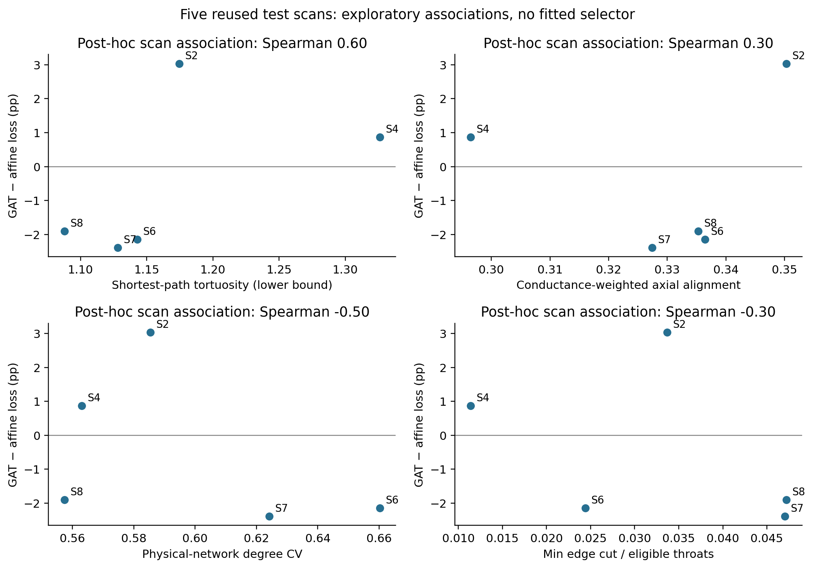
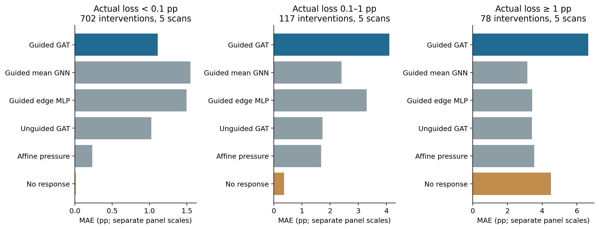
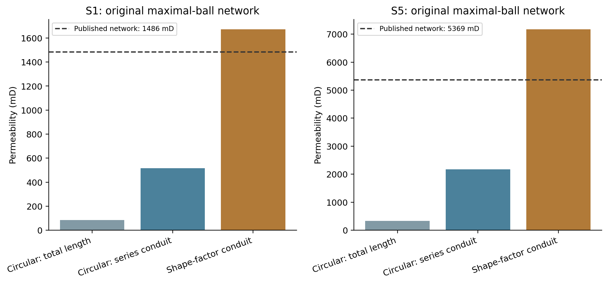

# TopoFlow — response to review of 4c48050

The review is supported by the new diagnostics. The GAT ranks useful throats but its response estimates are poorly calibrated. Neither an overall GAT advantage nor a validated topology-dependent switching rule has been established. Numerical solver checks now separate implementation agreement from the unresolved physical-reference issue. The findings are consolidated in [MANUSCRIPT.md](MANUSCRIPT.md).

## Scope and integrity

This is a post-hoc analysis of the same five test scans, not a new validation cohort. [analysis_plan.json](analysis_plan.json) records that the winner labels and one S2 debugging example were already known. No neural weights, calibration coefficients or switching rules are fitted. The original protocol, checkpoints and selection seal remain unchanged. The same twenty checkpoints and all original frozen predictions are retained.

## 1. Where does the learned ranking help?

| Scan | GAT loss (%) | Affine loss (%) | Path tortuosity | Axial alignment | Degree CV |
| --- | --- | --- | --- | --- | --- |
| S2 | 3.434 | 0.403 | 1.174 | 0.350 | 0.585 |
| S4 | 1.034 | 0.164 | 1.326 | 0.296 | 0.563 |
| S6 | 10.629 | 12.772 | 1.143 | 0.336 | 0.660 |
| S7 | 0.966 | 3.351 | 1.128 | 0.327 | 0.624 |
| S8 | 1.788 | 3.688 | 1.088 | 0.335 | 0.557 |

Path tortuosity is the shortest geometric inlet–outlet path length divided by boundary-plane separation, including the declared boundary conduits. It is a lower bound and is not bulk hydraulic tortuosity. Axial alignment weights squared axial direction cosines by d⁴/L on eligible internal throats. Degree CV describes active physical-pore connectivity. The edge-cut metric is an unweighted topological cut between inlet-adjacent and outlet-adjacent physical pores, normalized by eligible throat count; it is not a hydraulic min-cut.

| Geometry diagnostic | Spearman with GAT advantage |
| --- | --- |
| geodesic_tortuosity_lower_bound | 0.600 |
| axial_alignment_conductance_weighted | 0.300 |
| degree_cv | -0.500 |
| min_cut_per_eligible_throat | -0.300 |

The two scans favoring GAT have larger shortest-path tortuosity than the other three. The scan-level correlation with advantage is 0.60. Axial alignment and degree CV have the opposite signs to the candidate directional hypotheses recorded in the plan; cut density has the proposed negative sign. These mixed observations do not identify a reliable regime, threshold or mechanism. No fitted boundary, selector or causal claim is reported. All four candidate associations are shown, including those contradicting the hypotheses. The sample size remains five scan groups.

The affine energy-excess and pressure-error fields in the CSV use solved pressures and are outcome diagnostics only. They are never proposed as solver-free test-time inputs. A three-layer GAT also does not establish learned long-range hydraulic reasoning merely because its importance head is globally normalized.

## 2. Does low-impact imbalance explain the response result?

There are 897 distinct throat-dose interventions in the common pool. Of these, 702 (78.3%) produce less than 0.1 pp actual loss, 117 produce 0.1–1 pp, and 78 produce at least 1 pp. The bins are fixed, interpretable post-hoc descriptions of outcomes; they do not alter selections or enter the model. The ≥5 pp subset contains 18 interventions in 4 scans and overlaps the ≥1 pp group.

All table entries are response MAE in percentage points, averaged within graph, then within scan, then across available scans equally. Counts differ between bins. The ≥1 pp group covers 9 graphs in five scans; zero-count graphs are explicitly retained in the per-graph CSV and do not receive artificial zero errors. Every method uses identical cases in each comparison.

| Predictor | All | <0.1 pp | 0.1–1 pp | ≥1 pp | ≥5 pp subset |
| --- | --- | --- | --- | --- | --- |
| Guided GAT | 2.039 | 1.110 | 4.107 | 6.659 | 9.986 |
| Guided mean GNN | 1.858 | 1.549 | 2.406 | 3.154 | 4.688 |
| Guided edge MLP | 1.923 | 1.495 | 3.297 | 3.427 | 3.618 |
| Unguided GAT | 1.309 | 1.023 | 1.730 | 3.406 | 6.730 |
| Affine pressure | 0.748 | 0.233 | 1.683 | 3.539 | 5.698 |
| Conductance | 0.595 | 0.170 | 0.671 | 4.210 | 9.586 |
| No response | 0.461 | 0.010 | 0.363 | 4.510 | 10.451 |

The imbalance makes the no-response control competitive, but does not account for the full GAT deficit. Guided GAT MAE is 6.66 pp on ≥1 pp interventions versus 4.51 for no response, with signed bias +4.97 pp. On the GAT's own frozen top selections, evaluated for all three doses, its MAE is 10.95 pp versus 1.91 for no response. Predicted loss on those selections averages 12.85 pp while actual loss averages 1.91 pp. Ranking information therefore does not translate into calibrated amplitudes.

Some simpler learned controls improve on no response within the ≥1 pp subset, despite losing on the overall mixture. This supports reporting both consequential-intervention and whole-pool errors. The marginal GAT improvement in the small ≥5 pp tail is a threshold-sensitivity observation, not a replacement headline or an independently confirmed benefit. No correction is fitted to these test outcomes.

## 3. Physical-reference audit

Our solver and an independently assembled OpenPNM StokesFlow solve agree with a maximum relative difference of 2.1e-14 across ten SNOW crop networks and six original-network closure cases. These checks hold conductances, dimensions, viscosity and pressure conditions fixed. They make a simple linear-system assembly or Darcy-unit error an unlikely explanation for the discrepancy on the checked systems. They do not verify extracted geometry or real-rock permeability.

Four fixed crop diagnostics change one modeling assumption at a time. No factor is fitted to a reference:

| Crop diagnostic variant | Mean ratio | Minimum | Maximum |
| --- | --- | --- | --- |
| equivalent_diameter_direct | 3.637 | 1.115 | 5.719 |
| inscribed_direct | 1.000 | 1.000 | 1.000 |
| inscribed_direct_reservoir_contracted | 1.177 | 1.013 | 1.751 |
| inscribed_total_length | 0.931 | 0.890 | 0.957 |

Changing diameter definition has a large effect; removing artificial boundary-node resistance has a smaller but variable effect. These are crop sensitivity checks, not a correction to the full S1/S5 labels. Changing the closure would also change the intervention teacher and require a new declared study.

The archive supplies the original maximal-ball networks with pore/throat radii, shape factors and three conduit sub-lengths. Circular total-length, circular series-conduit and OpenPNM Valvatne–Blunt closures are compared on the same original graph. Endpoint-associated sub-lengths are reordered whenever endpoint IDs are reordered. The shape-factor calculation uses the installed OpenPNM model; a circular-tube limiting-case test verifies its interface.

| Sample | Closure on original network | Computed mD | Published network mD | Ratio |
| --- | --- | --- | --- | --- |
| S1 | circular_total_length | 85.304 | 1486.000 | 0.057 |
| S1 | circular_pore_throat_series | 516.505 | 1486.000 | 0.348 |
| S1 | valvatne_blunt_shape_factor | 1671.434 | 1486.000 | 1.125 |
| S5 | circular_total_length | 336.238 | 5369.000 | 0.063 |
| S5 | circular_pore_throat_series | 2172.818 | 5369.000 | 0.405 |
| S5 | valvatne_blunt_shape_factor | 7167.165 | 5369.000 | 1.335 |

The original-network shape-factor results are closer to the published scalar network values than either circular closure, but still differ by 12.5% for S1 and 33.5% for S5. Reservoir throats are removed and pressures imposed on their adjacent physical pores, following the OpenPNM importer convention; the legacy calculation's exact reservoir treatment is not reproduced. The original networks' boundary displacement is predominantly native coordinate x. The earlier SNOW result compared array-axis-0 flow nominally with published image Kz. These are different extraction and boundary/direction conventions. Consequently this is evidence of strong closure sensitivity, not an exact error decomposition or proof that the fourfold SNOW/image discrepancy is fixed.

The full-volume SNOW baselines remain 342.49 and 1187.48 mD, versus published image Kz values 1312 and 4440 mD. No new full SNOW extraction was attempted with only 0.8 GiB available at setup; the prior jobs peaked near 2.4 GB. The supplied original networks permit the cross-check without that extraction. The physical-reference discrepancy remains unresolved and the paper consistently states PNM-conditional conclusions.

## 4. Paper consolidation

The [comparative manuscript](MANUSCRIPT.md) preserves micro-CT, SNOW2, GAT and permeability-response prediction, while leading with the representation blind spot and rigorous learned-versus-analytical comparison. It contains completed findings rather than promises of unperformed results. It includes all three authors and source citations. The historical 24.8% oracle-pilot improvement is not substituted for the new frozen test results.

[VALIDATION_PROTOCOL.md](VALIDATION_PROTOCOL.md) separates an unexecuted prospective test from the manuscript. It specifies new independent source specimens, a continuous tortuosity association and development-only calibration; it does not fit a rule to S2/S4/S6/S7/S8.

The work is stronger as an exploratory comparative or benchmarking submission than as a claim of a superior GAT method. A publication decision still depends on venue fit and reviewer assessment. No numerical acceptance score or guarantee is assigned.
