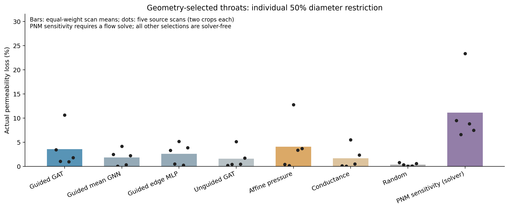
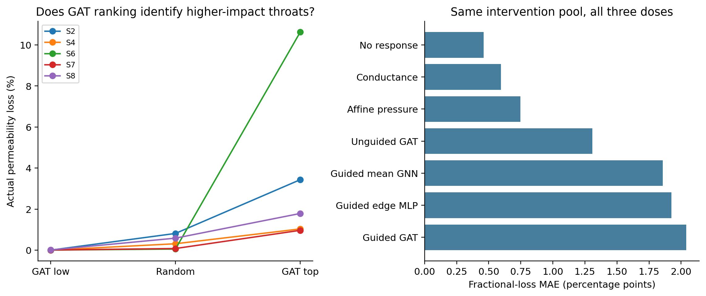
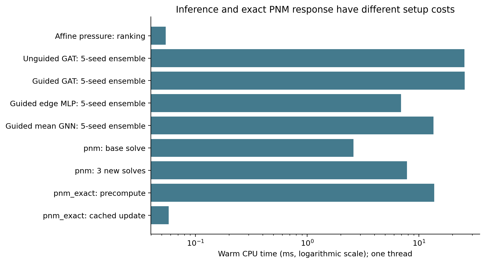

# TopoFlow — sealed solver-free discovery evaluation

The new experiment addresses the review's oracle-selection problem with a separately frozen five-scan validation group. The GAT identifies higher-impact throats than the random control on this aggregate endpoint. The affine-pressure ranking identifies larger actual losses than GAT without a flow solve. Guided GAT response MAE is 2.04 pp on the shared intervention pool, versus 0.46 pp for no response, which has the lowest error among evaluated predictors. The measured runtime also establishes no GAT advantage over the exact PNM alternatives on these graphs. Publication readiness remains limited by the reference-physics discrepancy, small scan count and the strength of simpler controls.

## Evidence and split

- Official Imperial ImagesICPSC2007 archive; original source headers retained; archive and checkpoint SHA-256 recorded in [protocol.json](protocol.json). The [source-byte audit](source_byte_audit.json) checks phase interpretation and rules out exact duplicates against locally available prior crops.
- New scan IDs: S2, S4, S6, S7, S8. These were not in the earlier development or external experiments. This is a sequential follow-up motivated by that pilot, not a retrospectively pristine overall research program.
- 10 accepted geometry crops, five source-scan groups, two fixed opposite-corner attempts per scan. No replacement search or outcome-based crop exclusion.
- Four frozen architectures, five seeds each, zero retraining. Training remains eight development crops from four earlier scans.
- [Selection seal](selection_seal.json) timestamps and hashes all rankings and selections before [outcome evaluation](evaluation_started.json). Selection performs zero flow solves. Geometry and frozen checkpoint identities are verified again before outcomes.
- 966 fresh numerical intervention solves check the exact finite-change identity. Repeated solves validate numerics; they do not increase the number of independent specimens.

## Primary result: actual loss at model-selected throats

Each value is the mean loss from restricting each selected throat separately by 50%. Percentages describe physical loss within the PNM, not prediction error.

| Selection method | Actual top-throat loss (%) | Cluster interval low | Cluster interval high | Sensitivity Spearman |
| --- | --- | --- | --- | --- |
| Guided GAT | 3.570 | 1.158 | 7.258 | 0.514 |
| Guided mean GNN | 1.855 | 0.588 | 3.113 | 0.371 |
| Guided edge MLP | 2.609 | 0.953 | 4.266 | 0.308 |
| Unguided GAT | 1.588 | 0.348 | 3.464 | 0.265 |
| Affine pressure | 4.076 | 0.897 | 8.481 | 0.390 |
| Conductance | 1.693 | 0.163 | 3.766 | 0.221 |
| Random | 0.368 | 0.115 | 0.621 | n/a |
| PNM sensitivity (solver) | 11.146 | 7.343 | 17.411 | n/a |

The random control is identical across methods. The PNM sensitivity ranking uses true base-flow dissipation and is explicitly solver-based; it is a first-order sensitivity control, not a guaranteed optimum for finite restrictions. The other rankings are computed from geometry before outcomes. See [per-scan values](per_scan_discovery.csv) and [paired comparisons](paired_scan_comparisons.json).

## Fair response comparison

All response predictors use the same intervention pool in each graph, covering every geometry-selected top/low/random throat at three doses. Graph means are averaged within scan and scan means equally; the number of throats selected by different methods cannot change the weighting. The affine/conductance response controls use normalized proxy importance and heuristic leverage (1−s)/2; they are ranking controls with an explicit heuristic response, not exact hydraulic solutions.

| Response predictor | Common-pool MAE (pp) | Cluster interval low | Cluster interval high |
| --- | --- | --- | --- |
| Guided GAT | 2.039 | 1.329 | 2.776 |
| Guided mean GNN | 1.858 | 1.232 | 2.595 |
| Guided edge MLP | 1.923 | 1.117 | 2.917 |
| Unguided GAT | 1.309 | 0.731 | 2.038 |
| Affine pressure | 0.748 | 0.538 | 0.920 |
| Conductance | 0.595 | 0.377 | 0.844 |
| No response | 0.461 | 0.247 | 0.717 |

[Seed response errors](seed_accuracy_summary_pp.csv) report mean/standard deviation across five single-seed scan-macro errors. They do not select the deployed seed or establish an independent sample size of 25.

## Measured costs

One CPU thread, five warmups, thirty measured calls per graph; exact all-throat precomputation uses five measured calls. Each table entry first takes the median calls in a graph, then averages the two crops within scan, then averages scans equally. The ensemble operation computes all-throat responses at all three doses. Three fresh PNM solves compute three 50% responses with the base permeability already available; their scope differs and is stated rather than equated. Exact precompute includes a base solve, factorization and all-edge leverage; cached readout excludes that setup.

| Method | Timed operation | Time (ms) |
| --- | --- | --- |
| affine_pressure | all_throat_scores | 0.054 |
| edge_gat | five_seed_ensemble_all_throats_three_doses | 25.514 |
| edge_gat | single_seed_all_throats_three_doses | 5.101 |
| guided_edge_gat | five_seed_ensemble_all_throats_three_doses | 25.694 |
| guided_edge_gat | single_seed_all_throats_three_doses | 5.314 |
| guided_edge_mlp | five_seed_ensemble_all_throats_three_doses | 6.902 |
| guided_edge_mlp | single_seed_all_throats_three_doses | 1.451 |
| guided_edge_sage | five_seed_ensemble_all_throats_three_doses | 13.528 |
| guided_edge_sage | single_seed_all_throats_three_doses | 2.776 |
| pnm | base_solve | 2.599 |
| pnm | three_fresh_50pct_solves_base_excluded | 7.808 |
| pnm_exact | base_and_all_throat_leverage_precompute | 13.673 |
| pnm_exact | cached_all_throats_three_doses | 0.058 |

Mean SNOW2 extraction is 6.755 s per crop; feature construction is 1.994 ms. Forward timing excludes graph batching, extraction and model/disk load. All twenty models stay resident during benchmarking. [resources.json](resources.json) reports observed process RSS and exact tensor/parameter bytes. RSS is not peak or incremental model memory.

## What the review now resolves

| Concern | New evidence | Remaining limit |
| --- | --- | --- |
| Solver-selected important test throats | Every deployed ranking and top/low/random selection sealed before outcomes | Teacher guidance remains PNM-derived during training |
| Reused external tests | New five-scan group, frozen prior checkpoints and matched controls | All scans are from the same archive; geology independence not certified |
| Unequal guidance | Guided GAT, mean GNN and edge MLP all fixed before new outcomes | Architecture sizes/selected epochs differ; no attention-specific conclusion |
| No comparable runtime evidence | Warm neural, fresh-solve, exact-precompute and cached-update timings | Small CPU graphs, no extrapolated speedup |
| Physical reference discrepancy | Conclusions explicitly restricted to declared PNM | S1/S5 discrepancy remains unresolved; no DNS or real-clogging validation |

## Relation to the literature

[Zhao and Xiao (2026)](https://doi.org/10.1016/j.jhydrol.2026.135602) combine learned conductances with a PNM and analyze permeability sensitivities. [Nassiri, van Paassen and Mahabadi (2026)](https://doi.org/10.1016/j.compgeo.2026.108292) examine location- and connectivity-dependent clogging responses. These primary publisher records were checked for this follow-up. Edge features, sensitivity and clogging-location effects therefore cannot supply a stand-alone novelty claim. The narrower question tested here is blind geometry-only selection and bounded counterfactual response prediction with matched controls. This literature check does not establish a universal first.

## Submission assessment

The result supports a controlled empirical study of where learned throat-response surrogates help or fail. It does not establish a new best GAT method. A workshop or exploratory paper can foreground the representation blind spot, sealed discovery experiment, analytical controls and exact-update comparison. A full methods paper still needs a convincing benefit over those controls, stronger independent source coverage and independently validated physics. The new [manuscript insert](MANUSCRIPT_INSERT.md) states completed methods and results directly, without presenting unperformed experiments as findings.
